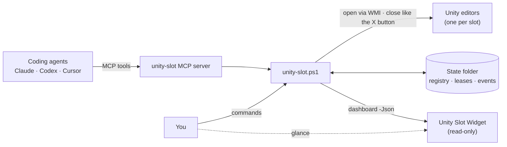
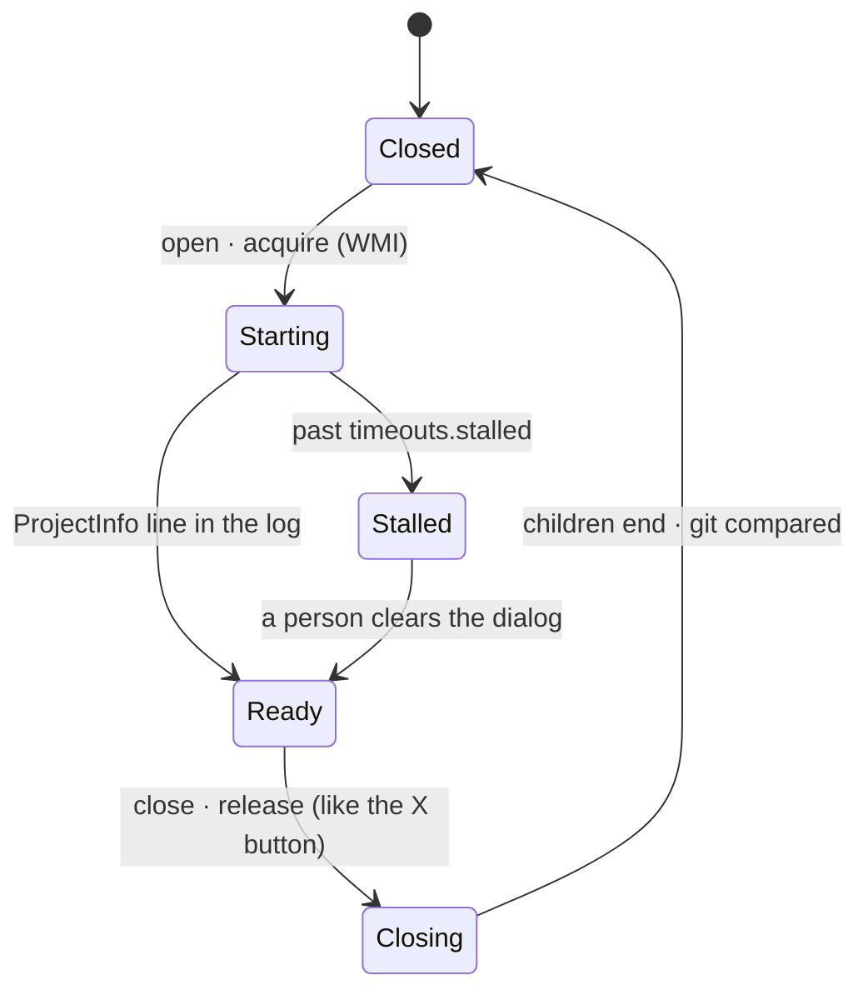
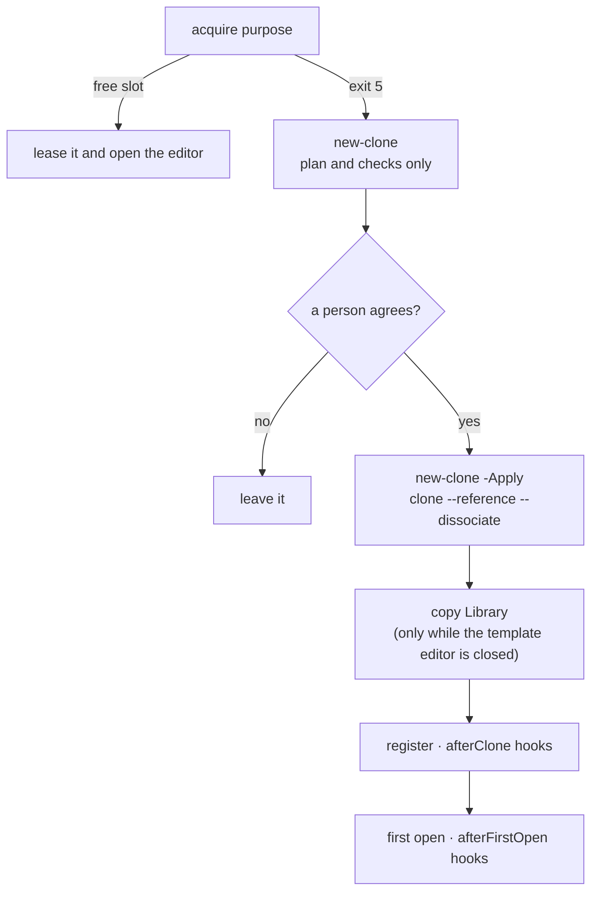
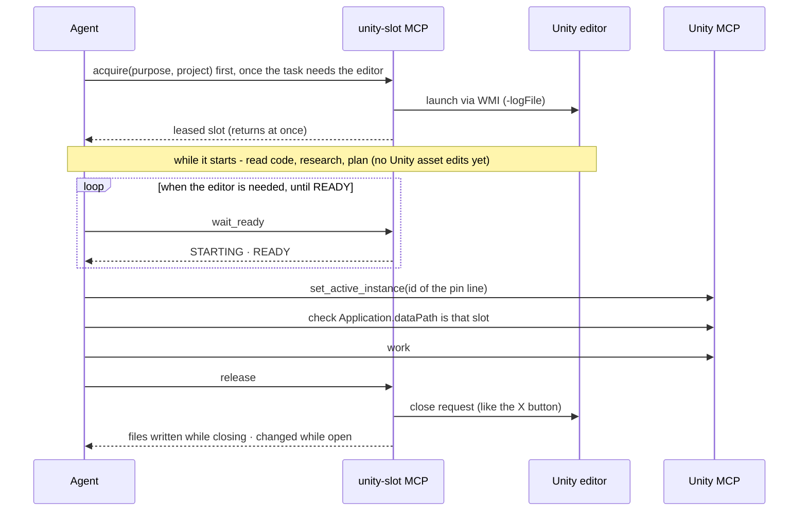

# unity-slot

[한국어](README.md)

Keep several clones of a Unity project as **slots** and open their editors only while someone needs them. AI coding agents lease a slot by purpose ("a WebGL clone", "any agent clone"), work in it, and release it. When no slot is free, unity-slot plans a new clone and creates it only after you agree.

It is one PowerShell script with a small library and an optional MCP server. It never kills a process, never clicks a dialog button, never switches a clone's platform, and starts no timers or scheduled tasks.

**Windows only.** It launches editors through WMI (`Win32_Process.Create`) and reads windows with Win32 APIs.

> **Unity licensing.** Running several Unity editors at the same time is governed by your Unity license and its terms. Check them yourself before you keep several slots open at once.

## At a glance



Agents and people use the same script: agents through MCP tools, people through commands. Files in the state folder remember who holds which slot. To keep the current state on screen, use the [widget](#widget).

## Why

Parallel work on one Unity project (one clone per agent, per platform, per branch) is easier with separate clones, but every open editor is expensive. One editor with its import workers, compiler server, shader compilers and other children took **5 to 12 GB of private memory** in our measurements. unity-slot keeps the clones registered and opens an editor only for the time it is used. It also checks that a clone is not already open, waits until the editor is really ready, and reports what changed when it closes.

## Requirements

- Windows 10 or 11 with Windows PowerShell 5.1 (built in). Nothing to install.
- Unity installed through Unity Hub, or any folder that holds `<version>\Editor\Unity.exe`.
- git.
- Optional: Python, only for `.py` hooks.

## Quick start

```powershell
git clone <this repository> unity-slot
cd unity-slot
copy config.example.json config.json      # optional: scan roots, clone root, hooks, ...

# register the clones of one project (dry run first, then -Apply)
.\unity-slot.ps1 scan -ScanRoot C:\Projects -Project my-org/my-game
.\unity-slot.ps1 scan -ScanRoot C:\Projects -Project my-org/my-game -Apply
.\unity-slot.ps1 slots
.\unity-slot.ps1 set MyGame-2 -Purpose agent,webgl -Memo 'agent clone for web fixes'

# lease a free slot, work, release it
.\unity-slot.ps1 acquire webgl -Project my-game -Owner me
.\unity-slot.ps1 release MyGame-2 -Owner me
```

From cmd or Git Bash, use `unity-slot.cmd <command> ...`.

`slots` looks like this (example names):

```text
Name          Platform  Branch       Mode      Agent  Purposes  State           Lease                              Project
------------  --------  -----------  --------  -----  --------  --------------  ---------------------------------  --------------
MyGame        Android   master       hot       false  main      open pid 37520  -                                  my-org/my-game
MyGame-1      Android   master       hot       true   agent     open pid 41236  claude:93ccbb47 until 11-07 00:10  my-org/my-game
MyGame-2      Android   master       ondemand  true   agent     closed          -                                  my-org/my-game
MyGame-WebGL  WebGL     build/webgl  ondemand  true   webgl     open pid 50112  codex:web-fix until 11-07 02:19    my-org/my-game
[slots] editors 3 open of max 6; registry %USERPROFILE%\.unity-slot\slots.json
```

## Concepts

- **Slot.** A registered clone folder (a git clone or worktree) of a Unity project. unity-slot detects its Unity version, branch, origin and platform. You set its *purposes* (free tags such as `agent`, `webgl`, `build`), its *mode* (`hot`: stays open, `ondemand`: opened when needed), whether agents may use it (`agentUse`) and a memo.
- **Lease.** A file per leased slot. It is created with `FileMode.CreateNew`, so two sessions cannot take the same slot. A lease expires after `leaseHours` (8). An expired lease frees a *closed* slot for the next acquire; it never closes an editor.
- **Free slot.** `agentUse` is on, a purpose or the platform fits, nobody else holds a valid lease, no batchmode Unity runs on it, and the editor is closed or the slot is `hot`. An on-demand slot that is open without a lease counts as in use. acquire prefers your own lease, then open hot slots, then the closed slot used most recently.
- **State.** `%USERPROFILE%\.unity-slot` (`UNITY_SLOT_HOME` moves it): `slots.json` (the registry) and `leases\`. It is not under AppData on purpose (see [Design notes](#design-notes)).

The editor of one slot moves like this. Leases come and go on their own.



A stalled editor is left as it is: unity-slot shows its windows and the `openStalled` hook output and hands it to a person.

## Commands

| Command | What it does |
|---|---|
| `open <slot\|clone> [-BuildTarget <platform>] [-NoWait]` | Starts the editor if the clone is not open and waits until it is ready. `-NoWait` returns right after the launch; then call `wait`. |
| `wait <slot\|clone> [-TimeoutSec 45]` | One bounded wait for a starting editor: READY, STARTING (exit 6), or stalled after 5 minutes (exit 2, with the editor's windows). The STARTING and stalled lines carry the last phase seen in Editor.log (starting the engine, script assemblies, asset refresh: packages, compiling scripts (%), reloading scripts, importing; opening the scene, finishing) and the number of import workers. Log tails (NOT RUNNING, stalled, timed out, EXITED) are masked first, then leave out `##utp` lines and cut each line at 300 characters. READY adds a `pin` line (see "Pinning the Unity MCP" below). |
| `close <slot\|clone> [-AllowDirty]` | Runs the beforeClose hooks, asks the editor to quit (same as clicking X), waits, then reports child processes that still run and files git sees as written by the close or changed while it was open. |
| `status [-Json] [-ShowCommandLine]` | Open editors with their child processes and memory (private / working set). |
| `slots [<slot>] [-Project <repo>] [-Json]` | The registry with each slot's state and lease; a slot or `-Project` narrows it. |
| `summary [<slot>] [-Project <repo>]` | A short status: open editors of the maximum and the commit, one table (slot, platform, mode, state, lease, agent use), warnings and lease notes (`note`), with the dashboard's states and flags. It skips what the table does not show (git, event history, memory), so it is faster than the dashboard (about 1.3 s on the test machine). The MCP `status` tool shows this by default. |
| `scan [-ScanRoot <dir>[,...]] [-Project <owner/repo>[,...]] [-Apply]` | Finds Unity projects under the scan roots, registers clones of the chosen projects and refreshes detected facts. |
| `set <slot> [-Purpose a,b] [-Mode hot\|ondemand] [-AgentUse true\|false] [-Memo <text>] [-BuildTarget <platform>]` | Changes your fields of a slot. |
| `acquire <purpose\|platform> [-Project <repo>] [-Owner <id>] [-Hours 8] [-NoOpen \| -NoWait]` | Leases a free slot that fits and opens its editor. Exit 5 when none is free. |
| `release <slot> [-Owner <id>] [-KeepOpen] [-AnyOwner]` | Closes the editor of an on-demand slot (a hot slot stays open) and drops the lease. Only the lease owner may release; `-AnyOwner` only when a person says so. |
| `renew <slot> [-Owner <id>] [-Hours 8]` | Extends a lease. |
| `new-clone <purpose\|platform> [-Project <repo>] [-From <slot>] [-Name <repo>-<n>] [-CloneRoot <dir>] [-NoOpen] [-Apply]` | Plans another clone (dry run). With `-Apply` it makes it: see [New clones](#new-clones). |
| `hooks [<slot> -HookEvent <event>]` | Shows the config file in use, the hooks per event and the extra commands. With a slot and `-HookEvent` it runs that event's hooks now. |
| `dashboard -Json [-Git basic\|full]` | One read-only JSON document for widgets and agents: see [Dashboard JSON](#dashboard-json). |
| `<extra command>` | A command your config adds (see [Extra commands](#extra-commands)). |

Options for any command: `-NoHooks` skips every hook, `-SkipHook a,b` skips the named ones, `-TimeoutSec`, `-StandbyWorkers`, `-EditorRoot`, `-Python`.
`-Project` accepts `owner/repo`, the repository name, or the end of it. `-Owner` defaults to `UNITY_SLOT_OWNER`, then `claude:<first 8 characters of CLAUDE_CODE_SESSION_ID>`, then `user@host`.

Exit codes: 0 ok (including "already open" and "already closed"), 1 error, 2 timed out (the editor is left running), 3 editor version not installed, 4 refused (lock held, a beforeClose hook, a batchmode run, someone else's lease, a platform switch, a failed new-clone check), 5 no free slot, 6 still starting.

## Configuration

Settings come from the first file found: `$env:UNITY_SLOT_CONFIG`, `config.json` next to `unity-slot.ps1` (git-ignored), or `%USERPROFILE%\.unity-slot\config.json`. Every key is optional. [config.example.json](config.example.json) lists them all with their defaults. Text values may use `{home}` (user profile), `{repo}` (the unity-slot folder), `{state}` (the state folder) and `%VARIABLES%`.

| Key | Default | Meaning |
|---|---|---|
| `editorRoots` | `C:\Program Files\Unity\Hub\Editor` | Folders that hold `<version>\Editor\Unity.exe`. The Hub's custom install folder is added automatically. |
| `scanRoots` | none | Folders whose subfolders are clones (scan). |
| `cloneRoot` | next to the template | Where new-clone creates clones. |
| `maxEditors` | 6 | acquire and new-clone refuse to start more editors. |
| `standbyWorkers` | 1 | Passed as `-standbyWorkerCount` (idle import workers). `-1` = not passed. |
| `leaseHours` | 8 | Lease length. |
| `python` | python on PATH | For `.py` hooks. |
| `timeouts` | open 300, close 240, wait 45, stalled 300, firstOpen 2400, firstOpenWithLibrary 900, hook 120 | Seconds. |
| `purposeRules` | see below | First guess at purposes during scan. |
| `platformAliases` | none | Extra platform names, for example `{ "mobile": "Android" }`. |
| `sceneBeacon` | none | Clone-relative JSON file an editor script of yours keeps up to date ([format](examples/hooks/scene-beacon.ps1)); the dashboard reports unsaved scenes from it. |
| `dashboard` | commitHighPercent 85, commitCriticalPercent 90, leaseExpiringMinutes 30, localOnlyOldDays 14, recentEvents 20 | Thresholds for the dashboard's flags; the commit ones also drive the capacity warnings. |
| `hooks` | none | Programs per event (next section). |
| `commands` | none | Extra commands. |

`purposeRules` guess a new slot's purposes from the folder name without the repository name (the suffix) and the platform: no suffix means `main` and not for agents (`mainWhenNoSuffix`), the first matching `suffix` rule adds its purposes (default: digits mean `agent`), the platform adds its purposes (`WebGL`: `webgl`, `Windows`: `windows`), and `fallback` applies when nothing matched. `notCopiedToNewClone` (default `main`) lists purposes a new clone does not inherit from its template. You confirm or change the result with `set`.

## Hooks

Hooks are programs that unity-slot runs at fixed points, so project-specific checks and setup stay out of the core.

| Event | When | Exit 4 means |
|---|---|---|
| `beforeClose` | before close asks an editor to quit | do not close (unless `-AllowDirty`) |
| `afterClose` | after the editor exited | - |
| `openStalled` | open or wait gave up on a starting editor, after the window list | - |
| `closeStalled` | close timed out and the editor is still open, after the window list | - |
| `afterClone` | new-clone made and registered a clone, before its first open | - |
| `afterFirstOpen` | a new clone's editor is ready for the first time | - |

```json
"hooks": {
  "beforeClose": [
    { "name": "scene-beacon", "run": ["{repo}\\examples\\hooks\\scene-beacon.ps1", "-Beacon", "Temp\\SceneBeacon.json"] }
  ],
  "afterClone": [
    { "name": "setup", "run": ["{repo}\\private\\setup-clone.ps1", "-Path", "{clone}"], "timeoutSec": 600 }
  ]
}
```

- `run` is the program and its arguments. `.ps1` runs in Windows PowerShell, `.py` with `python -X utf8`, `.cmd`/`.bat` with cmd.exe, anything else as is. The working folder is the clone.
- Arguments may use `{clone}`, `{slot}`, `{pid}` (editor process), `{log}` (Editor.log), `{platform}`, `{project}`, `{template}` (new-clone) and `{event}`. The same values are in the environment as `UNITY_SLOT_CLONE`, `UNITY_SLOT_SLOT`, ..., plus `UNITY_SLOT_EVENT`, `UNITY_SLOT_REPO` and `UNITY_SLOT_PYTHON`.
- Exit 0 is ok. Exit 4 refuses (it matters for `beforeClose`). Any other exit code is reported as a failed hook and the command goes on. A `.ps1` hook should end with an explicit `exit <n>`.
- Hooks run in order. A hook that runs longer than its `timeoutSec` (default `timeouts.hook`, 120) is reported and left running. It is never killed.
- `"enabled": false` keeps an entry without running it. `unity-slot hooks` lists what is configured; `unity-slot hooks <slot> -HookEvent beforeClose` runs one event by hand.
- `afterFirstOpen` hooks wait in the new slot's registry record until its editor is first ready, whoever opens it (new-clone, open, wait or acquire). They run once.

[examples/hooks/scene-beacon.ps1](examples/hooks/scene-beacon.ps1) refuses a close while unsaved scenes are reported. unity-slot cannot see unsaved scenes by itself, so the hook reads a small JSON file that an editor script in your project keeps up to date. The editor script is not included; the hook's header describes the format.

## Extra commands

`commands` adds commands to `unity-slot.ps1`. unity-slot dot-sources the script and calls the function. The function sees the same parameters (`$Target`, `$From`, `$Apply`, ...) and helpers (`Say`, `Read-Registry`, `Find-Slot`, `Invoke-Git`, ...) as the built-in commands.

```json
"commands": {
  "sync-notes": { "script": "{repo}\\private\\sync-notes.ps1", "function": "Invoke-SyncNotes", "usage": "sync-notes <slot> [-Apply]" }
}
```

A hook can call an extra command, for example `"run": ["{repo}\\unity-slot.ps1", "sync-notes", "{slot}", "-Apply"]`.

## Personal overlay

`config.json` and the `private/` folder are git-ignored. Keep your machine's settings in `config.json`, and your own hooks, extra commands and notes in `private/`. If `private/AGENTS.md` exists, coding agents working on this repository read it too.

## New clones

When `acquire` finds no free slot (exit 5), `new-clone` plans one. Without `-Apply` it only prints the plan and its checks. Show the plan to a person and run it with `-Apply` only after they agree.



1. **Checks.** The target folder must not exist. Free disk must be 1.2 times what is needed (files, `.git`, and `Library` when it is copied). Fewer editors than `maxEditors` must be open. It warns when the template branch has no upstream or has unpushed commits; the new clone only gets what origin has.
2. **Clone.** `git clone --reference <template> --dissociate --branch <template branch> <origin> <root>\<repo>-<n>`. A clone, not a worktree: a worktree cannot check out a branch another worktree has, and slots often share a branch. `--reference` makes it quick, `--dissociate` keeps it independent. The name is generic, `<repo>-<smallest free number>` (for example `MyGame-3`): no branch, feature, platform, agent or date, because the registry keeps purposes, platform and branch and a name cannot follow them when they change. `-Name` only picks another number (`<repo>-<n>`). Existing clones keep their names; renaming one breaks the settings tied to its absolute path, so do it only when its owner asks.
3. **Library.** Copied with robocopy only while the template editor is closed, which avoids a full import. Otherwise the first open imports everything.
4. **Register.** The template's purposes minus `notCopiedToNewClone`, on demand, agent use.
5. **afterClone hooks.**
6. **First open** with `-BuildTarget <template platform>` (up to 15 minutes with a copied Library, 40 without), then the **afterFirstOpen hooks**. With `-NoOpen` the first open is left to you (`open` + `wait`); the hooks still run at its first ready.

It never runs `git clean -x`, `git stash -a`, commits to the project repository, or switches a platform.

## MCP server

[mcp/unity-slot-mcp.ps1](mcp/unity-slot-mcp.ps1) is a stdio MCP server (JSON-RPC, one message per line) for coding agents. It needs nothing besides Windows PowerShell 5.1. Each tool call runs `unity-slot.ps1` in a child process and returns its text, so all logic stays in one place. The client starts the server per session and it ends when stdin closes.

| Tool | What it does |
|---|---|
| `status` | The short summary (as `summary`: a line with editors and commit, one table, warnings); `slot` or `project` narrow it. `format=json` returns the registry as JSON instead, `processes=true` editor processes and memory, `dashboard=true` (with `git=basic\|full`) the [dashboard document](#dashboard-json). |
| `acquire` | Leases a free slot for a purpose and starts its editor without waiting. |
| `open` | Starts a slot's editor and returns at once. |
| `wait_ready` | Waits up to 55 s per call: READY, STARTING (call again; last phase and import workers), STALLED, NOT RUNNING. |
| `close` | Closes like clicking X. `discard_unsaved=true` uses the official Unity CLI (`unity close`, no save; projects with `com.unity.pipeline` only) and is only for when a person said to drop changes. |
| `release` | Releases a slot you acquired. After the MCP server restarted, pass the owner your acquire showed as `owner`. |
| `create` | Plans a new clone (`new-clone -NoOpen`, so the plan shows the first open as open + wait_ready); `confirm=true` creates it (`-Apply`) after a person agreed to the plan. The clone always gets the generic `<repo>-<n>` name (no name argument). |

Tool calls stay short: open and acquire return right after the launch and wait_ready is called until READY, so no call sits on a client's tool timeout while Unity starts.

The lease owner is `claude:<session>` under Claude Code, which gives the MCP server its session id, so the owner stays the same when the server restarts. Codex passes only a fixed list of environment variables and Cursor passes no conversation or session id (checked 2026-11), so other clients get `<client name>:<random>`, a new id whenever the server restarts. Leases taken over MCP therefore record the client process (name, pid, start time), and `status` and a refused `release` add a note:

- A lease held by another id of the same client name: if this conversation acquired it before the server restarted (its acquire result showed that owner), call `release(slot="X", owner="<that owner>")`; otherwise it is another conversation's, so leave it.
- A lease whose client process has exited: orphaned (`lease-client-gone`), so hand it to the user, who releases it with the CLI `release <slot> -AnyOwner`.

Every result starts with `[unity-slot exit <code>: <meaning>, <seconds>s]`, for example `[unity-slot exit 0: ok, 1.2s]`, and the server logs `tools/call <tool> <seconds>s exit <code>` on stderr. `isError` is true for exit codes 1, 3 and 4. Next steps in the results name the tools, for example `wait_ready(slot="MyGame-2")` or `release(slot="MyGame-2")` (the owner only when it is not the session's own); the CLI keeps its command wording.

Capacity warnings: before a closed slot's editor starts (open, acquire, new-clone) and again when it reports READY, unity-slot prints `warn capacity: ...` lines when the open editors reach `maxEditors` or the commit charge reaches `dashboard.commitHighPercent` (85) or `commitCriticalPercent` (90), the same thresholds as the dashboard's flags. It only warns: nothing is refused, exit codes and leases stay as they are, and the line asks the agent to tell the user. Acquiring a hot slot that is already open adds no editor and is not checked. Tests can set the commit charge with `UNITY_SLOT_COMMIT_OVERRIDE=<percent>`.

Pinning the Unity MCP: [MCP for Unity](https://github.com/CoplayDev/unity-mcp) sends calls to the editor a session pinned, and with a single editor open the first call pins that one for the whole session, so a slot editor that opens later may not get the calls. acquire and READY therefore print a `pin` line with the editor's instance id (over MCP, `set_active_instance(instance="MyGame-2@1a2b3c4d")`). The id is `<project folder>@<hash>`, the hash being the first 8 hex digits of the SHA-1 of `Application.dataPath` in UTF-8 (forward slashes, ending in `/Assets`, upper-case drive letter). When a status file of that plugin (`%USERPROFILE%\.unity-mcp\unity-mcp-status-<hash>.json`) has the clone's `project_path`, its name and hash are used (tests point `UNITY_SLOT_UNITY_MCP_DIR` elsewhere).

The usual list of instances is the plugin's instances resource, but Claude Code cannot read that server's resources. Instead:

- Each `%USERPROFILE%\.unity-mcp\unity-mcp-status-<hash>.json` has `project_name`, `project_path`, `unity_port` and `last_heartbeat`, so `<project_name>@<hash>` gives the list.
- `set_active_instance(instance="1")` with a port number no editor uses fails with `Available: Name@hash (port N)`, the list. The pin does not change.

One piece of agent work goes like this:



Register it with the full path of your copy:

```powershell
claude mcp add --scope user unity-slot -- powershell.exe -NoProfile -NonInteractive -ExecutionPolicy Bypass -File C:\path\to\unity-slot\mcp\unity-slot-mcp.ps1
```

```toml
# Codex: ~/.codex/config.toml
[mcp_servers.unity-slot]
command = "powershell.exe"
args = ["-NoProfile", "-NonInteractive", "-ExecutionPolicy", "Bypass", "-File", "C:\\path\\to\\unity-slot\\mcp\\unity-slot-mcp.ps1"]
startup_timeout_sec = 30
tool_timeout_sec = 300
```

```json
// Cursor: mcp.json
{ "mcpServers": { "unity-slot": { "command": "powershell.exe",
  "args": ["-NoProfile", "-NonInteractive", "-ExecutionPolicy", "Bypass", "-File", "C:\\path\\to\\unity-slot\\mcp\\unity-slot-mcp.ps1"] } } }
```

The tools carry MCP annotations (protocol 2025-03-26 and later; a client on 2024-11-05 gets the tools without them): `status` and `wait_ready` are read-only; `acquire`, `open` and `create` change things but are not destructive (`create` reaches the network through `git clone`); `close` and `release` are marked destructive because they close an editor and `close` can drop unsaved changes with `discard_unsaved`. Hints do not grant anything: a client may still ask before a call, and in a non-interactive run (for example `codex exec`) the tools may need to be allowed in the client's approval settings.

A rule for agents can be this short: "Decide first whether the task needs the Unity editor; if you are not sure, do not open one. If it does, pull or switch branches while it is closed, then acquire a slot (purpose, project) before planning or research. While the editor starts (12 s to minutes), read code, research and plan, but edit Unity assets or scripts only after READY. When you need the editor, call wait_ready until READY, pin your Unity MCP to it with the `set_active_instance` call of the `pin` line, check that `Application.dataPath` is that slot, work, then release it. Take several slots together only while the commit is below the high mark (no `warn capacity` line), else one after another. Never switch platforms, never take slots leased by others, hand stalls to the user."

## Dashboard JSON

`unity-slot dashboard -Json [-Git basic|full]` prints one JSON document on stdout (one line, UTF-8, nothing else) and exits 0. On an error stdout stays empty, the message goes to stderr and the exit code is 1. It is read-only: one process snapshot, git with `--no-optional-locks`, no hooks, no command lines in the output. On the test machine it took about 1.7 s with `basic` and 2.2 s with `full`, PowerShell start included.

- **Top level:** `schema` (`unity-slot.dashboard/1`; a new major number means an incompatible change), `version`, `time`, `host`, `registry` (`path`, `updatedAt`, `maxEditors`), `system` (`commit` `usedGB`/`limitGB`/`percent`, `freePhysicalGB`, `editorsOpen`), `slots`, `unregisteredEditors`, `orphanWorkers`, `recentEvents`, `systemFlags`, `timing` (`totalMs`, `processMs`, `gitMs`). Times are ISO 8601 with the local offset, sizes GB with two decimals, missing values `null`.
- **Each slot:** the registry fields (`name`, `path`, `project`, `repo`, `kind`, `unity`, `platform`, `purposes`, `mode`, `agentUse`, `memo`), `exists`, `editor`, `lease`, `git`, `lastOpenedAt`, `lastClosedAt`, `flags`.
- **`editor.state`:** `closed`, `starting`, `ready`, `stalled` (not ready after `timeouts.stalled`), `unknown` (no per-clone log to read, for example an editor the Hub started), `batch`, `missing`. With an editor: `pid`, `startedAt`, `readyAt`, `readySeconds`, `launch` (`hub`/`direct`), `standby`, `lock`, `unsavedScene` (`sceneBeacon`), `memory` (`editorPrivGB`, `workersPrivGB`, `childrenPrivGB`, `totalPrivGB`, `totalWsGB`, `workers`, `children`).
- **`lease`:** `owner`, `need`, `acquiredAt`, `expiresAt`, `expired`, `openedByAcquire`, `host`, `client` (for a lease taken over MCP the client process's `name`, `pid`, `startedAt`, `alive`, otherwise `null`), or `null` without a lease.
- **`git`:** `level`, `branch`, `upstream`, `upstreamGone`, `changes`, `ahead`, `behind`, `lastFetchAt`, `commonDir`, `error`. With `full` also `localOnly` (`commits` on local branches that no remote-tracking ref has, `oldestAt`), `branches` (`total`, `noUpstream`, `upstreamGone`), `stash`, `worktrees` (other working folders of the same repository). Slots that share a git directory are counted once. Nothing is fetched.
- **`flags`:** `open-without-lease` (an on-demand slot open without a lease), `lease-expired-open`, `lease-expiring`, `lease-client-gone` (the MCP client process that took the lease has exited), `stalled`, `unsaved-scene`, `stale-lock` (closed, but `Temp\UnityLockfile` is held), `batch-running`, `missing-path`, `local-only-old` (`full` only). **`systemFlags`:** `commit-high`, `commit-critical`, `editors-at-max`.

Two files in the state folder go with it:

- **`events.jsonl`:** one line per `open`, `ready`, `close`, `acquire`, `release`, `renew`, `takeover` (an expired lease taken over) and `refused`, for example `{"time":"...","event":"close","slot":"MyGame-2","path":"...","owner":"claude:1a2b3c4d","pid":4120,"via":"cli","detail":{"closeSeconds":4.4,"commitDeltaGB":-7.8,"changedFiles":0}}`. `via` is `cli` or `mcp`. Above 1 MB it moves to `events-prev.jsonl`. `lastOpenedAt`, `lastClosedAt` and `recentEvents` come from it.
- **`install.json`:** `{"script":"<full path of unity-slot.ps1>","version":"...","schema":1}`, refreshed by every run, so a widget finds the core without settings. While it points at another copy that exists, no other copy replaces it, newer or not (development checkouts run too). To move it, delete it; the next copy that runs takes it.

## Widget

[Unity Slot Widget](https://github.com/cyKim0115/unity-slot-widget) is a small Tauri widget that keeps this dashboard document on the desktop. For each slot it shows the editor state (closed, starting, ready, stalled), its uptime, the lease owner, the editor tree's memory, and local git state such as commits on no remote. It also raises warnings, for example an editor open without a lease or a high system commit.

- **Read-only.** It never opens, closes or leases a slot; `dashboard -Json` makes every decision.
- **Finding the core.** It finds the core through `install.json`, so on a PC where unity-slot has run once there is nothing to set.
- **Refresh.** It checks every 30 seconds, every 5 seconds while an editor is starting, and at once when a Unity process or a state-folder file changes. It stops while hidden.

## Design notes

- **Launch through WMI.** Some agent shells run inside an app container (for example a desktop app installed as an MSIX package). A child started there with `Start-Process` had its `%LOCALAPPDATA%` writes redirected into the app's private folder and inherited the shell's environment, secrets included. An editor started with `Win32_Process.Create` runs outside: real AppData, none of the shell's variables, a normal window (its parent is `WmiPrvSE.exe`). The state folder is not under AppData for the same reason.
- **Without the Hub.** The editor connects to the running Licensing Client and gets its entitlement. The log notes `Access token is unavailable; failed to update` because no Hub token was passed; opening works.
- **Ready.** The editor is started with `-logFile <clone>\Logs\Editor.log` and is ready when the `##utp:` `ProjectInfo` line of that process id appears. Older editors without it are accepted 15 s after `[Project] Loading completed`. The previous log is kept as `Editor-prev.log`.
- **Already open.** Running `Unity.exe` command lines are matched on `-projectPath` (both the Hub's `-projectpath C:\x` and the import workers' `"-projectPath" "C:/x"`). If none matches but `Temp\UnityLockfile` is held, open refuses.
- **Close.** `CloseMainWindow`, the same as clicking X, so Unity saves as usual. unity-slot waits, then watches the children (import workers, compiler server, MCP servers) for 30 s. It compares `git status` just before the close and with the snapshot that open saved in `Logs\unity-slot-open.txt`, so you see what the close wrote and what changed while the editor was open (for example assets the editor re-serialized). It only reports; nothing is reverted.
- **Platform.** An open editor's platform comes from its window title, a closed clone's from the active platform group in `Library\EditorUserBuildSettings.asset`. `Library\PlayerDataCache` only shows the last player build. `-BuildTarget` is refused when it would switch a clone's platform, because that reimports everything.
- **Standby workers.** Unity 6000.6 rejects `-standbyWorkerCount 0` ("Failed to set standby worker count to 0") and keeps its default of 2; it accepts 1, the default here.
- **Secrets.** Hub-launched editors carry `-accessToken` and `-hubSessionId` on their command line and at the top of Editor.log; import workers carry `-cbmEditorLicense` and `-cbmMachineId`. Every command line or log line unity-slot prints has these values replaced with `***`.
- **Never.** No killed processes, no clicked dialogs, no scheduled tasks or timers that close editors later, no `git pull`, no platform switches, no audio changes. New clones only with `-Apply` after a person agreed.

## Tested with

Windows 10 22H2, Windows PowerShell 5.1, Unity 6000.6.0f1, two projects with several clones each on one machine (up to five editors open at a time). A warm open took 12 to 14 s, the first open after days about 60 s, a close 4 to 13 s. Other Unity versions and machines are untested; reports are welcome.

## Tests

`tests\run-tests.ps1` tests the core and the MCP server with a fake `Unity.exe` (a stub) instead of Unity. It never reads or writes the real registry, leases or events (`%USERPROFILE%\.unity-slot`). Nothing to install.

```powershell
powershell -NoProfile -ExecutionPolicy Bypass -File tests\run-tests.ps1                 # everything (3 to 4 minutes)
powershell -NoProfile -ExecutionPolicy Bypass -File tests\run-tests.ps1 -Phase 1        # current behavior only
powershell -NoProfile -ExecutionPolicy Bypass -File tests\run-tests.ps1 -Only '^close\.' -KeepRoot
powershell -NoProfile -ExecutionPolicy Bypass -File tests\run-tests.ps1 -List
```

- **Stub.** `tests\stub\UnityStub.cs` is built with the .NET Framework compiler that ships with Windows (`csc.exe`). It reads `-projectPath`, `-logFile`, `-standbyWorkerCount` and `-buildTarget` and imitates a Unity-style window title, `Temp\UnityLockfile`, the `##utp` `ProjectInfo` line in Editor.log, closing on X (CloseMainWindow), dialogs with native buttons, the scene beacon and import workers (`-parentPid`). Its behavior comes from a control file in the clone, `Temp\unity-stub.txt`: `normal`, `never-ready`, `dialog`, `slow-close`, `ignore-close`, `dirty`, `exit-early`. A process started through WMI does not get the caller's environment, so there are no environment switches.
- **Isolation.** The test folder (default `%TEMP%\unity-slot-tests\<time>`) holds the stub, a local bare origin and fake clones (`MyGame`, `MyGame-1`, `MyGame-2`, `MyGame-Web`); each group gets its own `UNITY_SLOT_HOME` and `UNITY_SLOT_CONFIG`. The fake clones use Unity version `9999.0.0f1`, so no real editor can open. Before and after a run it checks that the real `slots.json` and `install.json` kept their time stamp and hash.
- **Groups.** `lease` (leases, races, taking over expired leases, no free slot, hot slots), `close` (refused close, timeouts, batchmode, lock file), `start` (STARTING, STALLED, the dialog list, `-TimeoutSec`, versions, platforms), `report` (`events.jsonl`, the `install.json` pointer, the dashboard, secrets), `mcp` (protocol, a lease flow), `phase2` (MCP next steps, call times, annotations, the status summary, capacity warnings, startup phases; improvements not in the core yet are SKIP). Groups run in separate processes, three at a time; the tests of a group run one after another.
- **Results.** Each test prints PASS, FAIL, KNOWN or SKIP and its time; exit 0 when nothing failed. KNOWN marks a reproduction of a core problem listed in [tests/FINDINGS.md](tests/FINDINGS.md). When everything passed the test folder is deleted, otherwise it stays (`envs\<group>\cli.log` has the output of every run).
- **Rules kept.** No process is killed, stubs included: a test asks a stub to end through its control file, and a stub that does not end is only reported (it ends by itself after 10 minutes). Dialogs are listed, never clicked. Stub windows open off screen without taking the focus, and they make no sound.
- **App-package shells.** A shell of an app installed as an MSIX package writes to AppData through a private copy, which a stub started through WMI cannot see. From such a shell the run refuses a test folder under AppData; pass `-Root` with another folder.

## License

[MIT](LICENSE)
