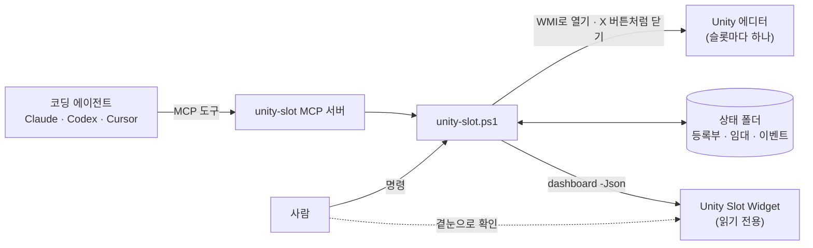
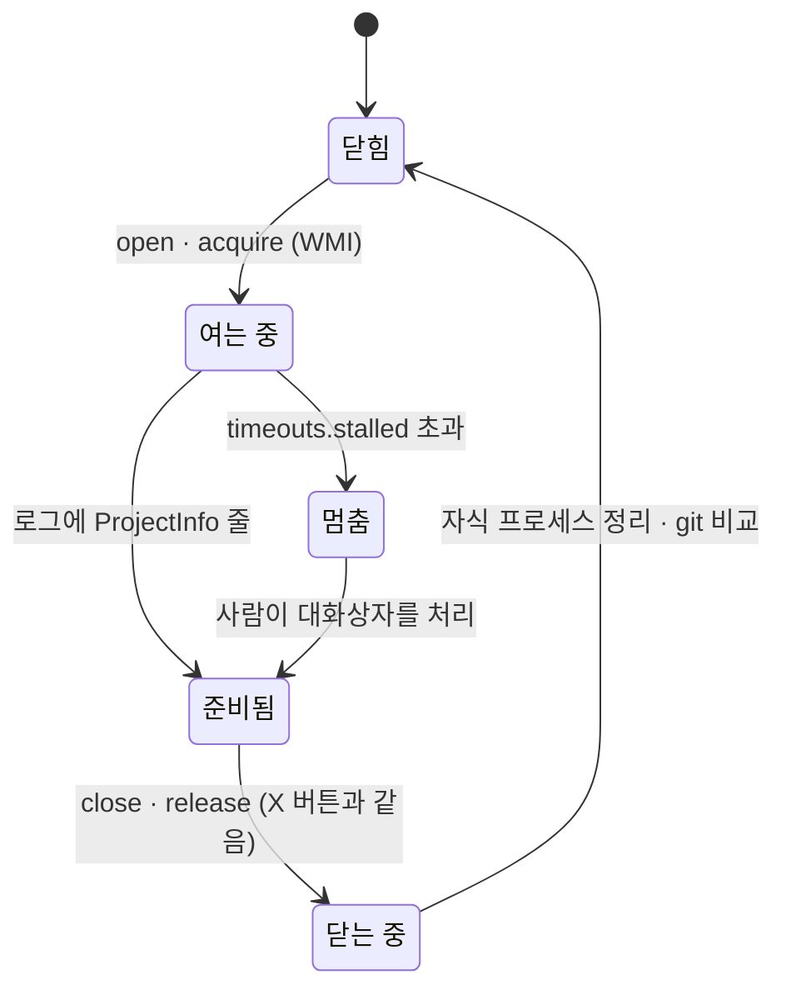
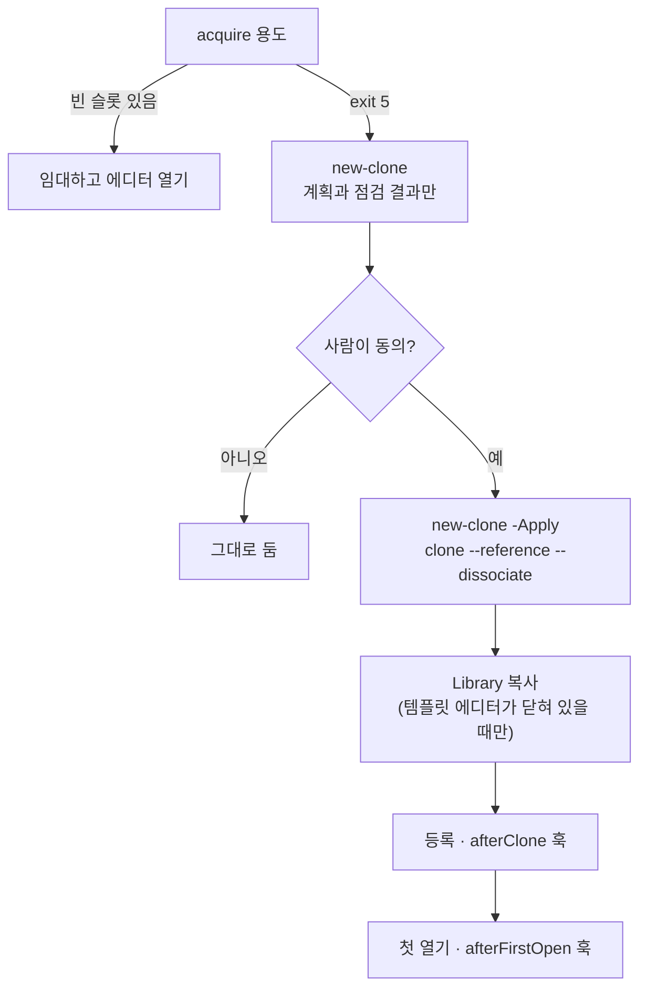
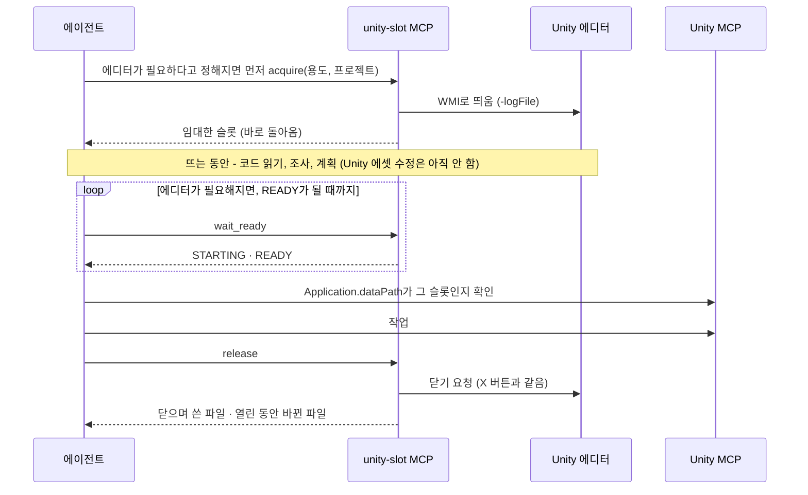

# unity-slot

[English](README.en.md)

Unity 프로젝트의 클론 여러 개를 **슬롯**으로 등록해 두고, 에디터는 쓰는 동안에만 엽니다. AI 코딩 에이전트는 용도(「WebGL 클론」, 「아무 에이전트 클론」)로 슬롯을 임대해 그 안에서 일하고, 끝나면 놓습니다. 빈 슬롯이 없으면 새 클론 계획을 보여 주고, 사람이 동의해야 만듭니다.

PowerShell 스크립트 하나와 작은 라이브러리, 선택으로 쓰는 MCP 서버로 되어 있습니다. 프로세스를 강제 종료하지 않고, 대화상자 버튼을 누르지 않고, 클론의 플랫폼을 바꾸지 않고, 타이머나 예약 작업을 만들지 않습니다.

**Windows 전용입니다.** 에디터를 WMI(`Win32_Process.Create`)로 띄우고 창은 Win32 API로 읽습니다.

> **Unity 라이선스.** Unity 에디터를 동시에 여러 개 실행하는 일은 각자의 Unity 라이선스와 약관을 따릅니다. 슬롯 여러 개를 동시에 열어 두기 전에 직접 확인하세요.

## 한눈에 보기



에이전트와 사람은 같은 스크립트를 씁니다. 에이전트는 MCP 도구로, 사람은 명령으로 부릅니다. 누가 어떤 슬롯을 잡았는지는 상태 폴더의 파일이 기억합니다. 지금 상태를 늘 띄워 두고 보려면 [위젯](#위젯)을 쓰세요.

## 왜 만들었나

한 Unity 프로젝트를 나눠 작업할 때(에이전트별·플랫폼별·브랜치별 클론) 클론을 따로 두면 편하지만, 열린 에디터 하나하나가 비쌉니다. 임포트 워커·컴파일러 서버·셰이더 컴파일러 같은 자식 프로세스까지 더하면 에디터 하나가 **Private 메모리 5~12GB**를 썼습니다(실측). unity-slot은 클론을 등록해 두고 쓰는 동안에만 에디터를 엽니다. 이미 열린 클론인지 확인하고, 에디터가 정말 준비될 때까지 기다리고, 닫을 때 무엇이 바뀌었는지 알려 줍니다.

## 필요한 것

- Windows 10·11과 Windows PowerShell 5.1(기본 탑재). 따로 설치할 것은 없습니다.
- Unity Hub로 설치한 Unity, 또는 `<버전>\Editor\Unity.exe`가 있는 폴더.
- git.
- 선택: `.py` 훅을 쓸 때만 Python.

## 빠르게 시작하기

```powershell
git clone <이 저장소> unity-slot
cd unity-slot
copy config.example.json config.json      # 선택: 스캔 루트, 클론 위치, 훅 등

# 한 프로젝트의 클론을 등록합니다 (먼저 dry-run, 그다음 -Apply)
.\unity-slot.ps1 scan -ScanRoot C:\Projects -Project my-org/my-game
.\unity-slot.ps1 scan -ScanRoot C:\Projects -Project my-org/my-game -Apply
.\unity-slot.ps1 slots
.\unity-slot.ps1 set MyGame-2 -Purpose agent,webgl -Memo '웹 수정용 에이전트 클론'

# 빈 슬롯을 임대하고, 일하고, 놓습니다
.\unity-slot.ps1 acquire webgl -Project my-game -Owner me
.\unity-slot.ps1 release MyGame-2 -Owner me
```

cmd나 Git Bash에서는 `unity-slot.cmd <명령> ...`으로 쓰세요.

`slots`는 이렇게 보입니다(예시 이름).

```text
Name          Platform  Branch       Mode      Agent  Purposes  State           Lease                              Project
------------  --------  -----------  --------  -----  --------  --------------  ---------------------------------  --------------
MyGame        Android   master       hot       false  main      open pid 37520  -                                  my-org/my-game
MyGame-1      Android   master       hot       true   agent     open pid 41236  claude:93ccbb47 until 11-07 00:10  my-org/my-game
MyGame-2      Android   master       ondemand  true   agent     closed          -                                  my-org/my-game
MyGame-WebGL  WebGL     build/webgl  ondemand  true   webgl     open pid 50112  codex:web-fix until 11-07 02:19    my-org/my-game
[slots] editors 3 open of max 6; registry %USERPROFILE%\.unity-slot\slots.json
```

## 개념

- **슬롯.** 등록한 Unity 프로젝트 클론 폴더(git clone이나 worktree)입니다. Unity 버전·브랜치·origin·플랫폼은 unity-slot이 감지합니다. *용도*(`agent`·`webgl`·`build` 같은 자유 태그), *운용*(`hot`: 늘 열어 둠, `ondemand`: 필요할 때 엶), 에이전트 사용 여부(`agentUse`), 메모는 사람이 정합니다.
- **임대.** 임대한 슬롯마다 파일 하나입니다. `FileMode.CreateNew`로 만들어서 두 세션이 같은 슬롯을 잡지 못합니다. `leaseHours`(8시간) 뒤에 만료됩니다. 만료된 임대는 *닫힌* 슬롯을 다음 acquire에 내줍니다. 에디터를 닫지는 않습니다.
- **빈 슬롯.** `agentUse`가 켜져 있고, 용도나 플랫폼이 맞고, 남의 유효한 임대가 없고, batchmode Unity가 돌고 있지 않고, 에디터가 닫혀 있거나 `hot` 슬롯이어야 합니다. 임대 없이 열려 있는 온디맨드 슬롯은 누가 쓰는 중으로 봅니다. acquire는 내 임대, 열린 hot 슬롯, 가장 최근에 쓴 닫힌 슬롯 순으로 고릅니다.
- **상태.** `%USERPROFILE%\.unity-slot`(`UNITY_SLOT_HOME`으로 옮길 수 있습니다)에 `slots.json`(등록부)과 `leases\`가 있습니다. 일부러 AppData 밖에 둡니다([설계 메모](#설계-메모) 참고).

슬롯 하나의 에디터는 이렇게 움직입니다. 임대는 이와 따로 붙고 풀립니다.



멈춘 에디터는 그대로 둡니다. 창 목록과 `openStalled` 훅 결과를 보여 주고 사람에게 넘깁니다.

## 명령

| 명령 | 하는 일 |
|---|---|
| `open <슬롯\|클론> [-BuildTarget <플랫폼>] [-NoWait]` | 클론이 열려 있지 않으면 에디터를 띄우고 준비될 때까지 기다립니다. `-NoWait`면 띄우고 바로 끝나니, 그다음 `wait`를 부르면 됩니다. |
| `wait <슬롯\|클론> [-TimeoutSec 45]` | 시작 중인 에디터를 한 번 정해진 시간만큼 기다립니다. READY, STARTING(exit 6), 5분이 넘으면 멈춤으로 봅니다(exit 2, 에디터 창 목록). STARTING·멈춤 줄에는 Editor.log에서 마지막으로 본 단계(엔진 시작, 스크립트 어셈블리, 에셋 새로고침의 패키지·스크립트 컴파일(%)·스크립트 다시 로드·임포트, 씬 열기, 마무리)와 임포트 워커 수가 붙습니다. |
| `close <슬롯\|클론> [-AllowDirty]` | beforeClose 훅을 돌리고, X 버튼처럼 닫기를 요청하고, 기다린 뒤 남은 자식 프로세스와 git이 보는 변경(닫으며 쓴 파일, 열린 동안 바뀐 파일)을 알려 줍니다. |
| `status [-Json] [-ShowCommandLine]` | 열린 에디터와 자식 프로세스, 메모리(Private/작업 집합)를 보여 줍니다. |
| `slots [<슬롯>] [-Project <repo>] [-Json]` | 등록부와 슬롯별 상태·임대를 보여 줍니다. 슬롯이나 `-Project`로 좁힐 수 있습니다. |
| `summary [<슬롯>] [-Project <repo>]` | 짧은 상태를 보여 줍니다: 열린 에디터 수/최대·커밋 한 줄, 표 하나(슬롯·플랫폼·운용·상태·임대·에이전트 사용), 경고, 임대 안내(`note`). 상태와 경고는 대시보드 판정을 쓰되 표에 없는 git·이벤트 이력·메모리는 읽지 않아 대시보드보다 빠릅니다(시험 기기 약 1.3초). MCP `status` 도구의 기본 출력입니다. |
| `scan [-ScanRoot <폴더>[,...]] [-Project <owner/repo>[,...]] [-Apply]` | 스캔 루트 아래 Unity 프로젝트를 찾아 고른 프로젝트의 클론을 등록하고, 감지한 값을 새로 고칩니다. |
| `set <슬롯> [-Purpose a,b] [-Mode hot\|ondemand] [-AgentUse true\|false] [-Memo <글>] [-BuildTarget <플랫폼>]` | 슬롯에서 사람이 정하는 칸을 바꿉니다. |
| `acquire <용도\|플랫폼> [-Project <repo>] [-Owner <id>] [-Hours 8] [-NoOpen \| -NoWait]` | 맞는 빈 슬롯을 임대하고 에디터를 엽니다. 없으면 exit 5. |
| `release <슬롯> [-Owner <id>] [-KeepOpen] [-AnyOwner]` | 온디맨드 슬롯이면 에디터를 닫고(hot 슬롯은 열어 둡니다) 임대를 풉니다. 임대 주인만 할 수 있습니다. `-AnyOwner`는 사람이 시킬 때만 쓰세요. |
| `renew <슬롯> [-Owner <id>] [-Hours 8]` | 임대를 늘립니다. |
| `new-clone <용도\|플랫폼> [-Project <repo>] [-From <슬롯>] [-Name <repo>-<번호>] [-CloneRoot <폴더>] [-NoOpen] [-Apply]` | 새 클론 계획(dry-run)을 보여 줍니다. `-Apply`면 만듭니다. [새 클론](#새-클론) 참고. |
| `hooks [<슬롯> -HookEvent <이벤트>]` | 쓰는 설정 파일, 이벤트별 훅, 추가 명령을 보여 줍니다. 슬롯과 `-HookEvent`를 주면 그 이벤트의 훅을 지금 돌립니다. |
| `dashboard -Json [-Git basic\|full]` | 위젯·에이전트용 읽기 전용 JSON 문서 하나를 냅니다. [대시보드 JSON](#대시보드-json) 참고. |
| `<추가 명령>` | 설정에서 더한 명령([추가 명령](#추가-명령)). |

모든 명령에 쓰는 옵션: `-NoHooks`(훅 모두 건너뜀), `-SkipHook a,b`(이름으로 건너뜀), `-TimeoutSec`, `-StandbyWorkers`, `-EditorRoot`, `-Python`.
`-Project`에는 `owner/repo`, 저장소 이름, 그 이름의 끝을 쓸 수 있습니다. `-Owner` 기본값은 `UNITY_SLOT_OWNER`, 없으면 `claude:<CLAUDE_CODE_SESSION_ID 앞 8자>`, 없으면 `user@host`입니다.

종료 코드: 0 정상(「이미 열림」·「이미 닫힘」 포함), 1 오류, 2 시간 초과(에디터는 그대로 둠), 3 에디터 버전 미설치, 4 거부(잠금, beforeClose 훅, batchmode 실행, 남의 임대, 플랫폼 전환, new-clone 점검 실패), 5 빈 슬롯 없음, 6 아직 시작 중.

## 설정

설정은 처음 찾은 파일에서 읽습니다: `$env:UNITY_SLOT_CONFIG`, `unity-slot.ps1` 옆의 `config.json`(git 무시), `%USERPROFILE%\.unity-slot\config.json`. 모든 키는 선택입니다. [config.example.json](config.example.json)에 키와 기본값이 다 있습니다. 글자 값에는 `{home}`(사용자 프로필), `{repo}`(unity-slot 폴더), `{state}`(상태 폴더), `%환경변수%`를 쓸 수 있습니다.

| 키 | 기본값 | 뜻 |
|---|---|---|
| `editorRoots` | `C:\Program Files\Unity\Hub\Editor` | `<버전>\Editor\Unity.exe`가 있는 폴더. Hub의 사용자 지정 설치 폴더는 자동으로 더합니다. |
| `scanRoots` | 없음 | 하위 폴더가 클론인 폴더(scan). |
| `cloneRoot` | 템플릿 옆 | new-clone이 클론을 만드는 곳. |
| `maxEditors` | 6 | acquire·new-clone이 이보다 많이 띄우지 않습니다. |
| `standbyWorkers` | 1 | `-standbyWorkerCount`로 넘깁니다(쉬는 임포트 워커 수). `-1`이면 넘기지 않습니다. |
| `leaseHours` | 8 | 임대 시간. |
| `python` | PATH의 python | `.py` 훅용. |
| `timeouts` | open 300, close 240, wait 45, stalled 300, firstOpen 2400, firstOpenWithLibrary 900, hook 120 | 초. |
| `purposeRules` | 아래 | scan이 잡는 용도 초안. |
| `platformAliases` | 없음 | 플랫폼 별칭. 예: `{ "mobile": "Android" }` |
| `sceneBeacon` | 없음 | 프로젝트의 에디터 스크립트가 갱신하는 클론 기준 JSON 파일([형식](examples/hooks/scene-beacon.ps1)). 대시보드가 미저장 씬을 여기서 읽습니다. |
| `dashboard` | commitHighPercent 85, commitCriticalPercent 90, leaseExpiringMinutes 30, localOnlyOldDays 14, recentEvents 20 | 대시보드 경고 표시의 기준값. 커밋 기준은 수용량 경고에도 씁니다. |
| `hooks` | 없음 | 이벤트별 프로그램(다음 절). |
| `commands` | 없음 | 추가 명령. |

`purposeRules`는 폴더 이름에서 저장소 이름을 뺀 나머지(접미사)와 플랫폼으로 새 슬롯의 용도를 짐작합니다. 접미사가 없으면 `main`이고 에이전트용이 아닙니다(`mainWhenNoSuffix`). 처음 맞는 `suffix` 규칙의 용도를 더합니다(기본: 숫자면 `agent`). 플랫폼의 용도를 더합니다(`WebGL`: `webgl`, `Windows`: `windows`). 아무것도 안 맞으면 `fallback`을 씁니다. `notCopiedToNewClone`(기본 `main`)은 새 클론이 템플릿에서 물려받지 않는 용도입니다. 결과는 사람이 `set`으로 확인하거나 고칩니다.

## 훅

훅은 unity-slot이 정해진 시점에 돌리는 프로그램입니다. 프로젝트마다 다른 점검과 준비를 코어 밖에 두려고 씁니다.

| 이벤트 | 시점 | exit 4의 뜻 |
|---|---|---|
| `beforeClose` | close가 에디터에 닫기를 요청하기 전 | 닫지 않음(`-AllowDirty`면 무시) |
| `afterClose` | 에디터가 끝난 뒤 | - |
| `openStalled` | open이나 wait가 시작 중인 에디터를 더 기다리지 않을 때, 창 목록 다음 | - |
| `closeStalled` | close가 시간 초과로 끝나고 에디터가 아직 열려 있을 때, 창 목록 다음 | - |
| `afterClone` | new-clone이 클론을 만들고 등록한 뒤, 첫 열기 전 | - |
| `afterFirstOpen` | 새 클론의 에디터가 처음 준비됐을 때 | - |

```json
"hooks": {
  "beforeClose": [
    { "name": "scene-beacon", "run": ["{repo}\\examples\\hooks\\scene-beacon.ps1", "-Beacon", "Temp\\SceneBeacon.json"] }
  ],
  "afterClone": [
    { "name": "setup", "run": ["{repo}\\private\\setup-clone.ps1", "-Path", "{clone}"], "timeoutSec": 600 }
  ]
}
```

- `run`은 프로그램과 인자입니다. `.ps1`은 Windows PowerShell, `.py`는 `python -X utf8`, `.cmd`·`.bat`은 cmd.exe, 나머지는 그대로 실행합니다. 작업 폴더는 그 클론입니다.
- 인자에는 `{clone}`, `{slot}`, `{pid}`(에디터 프로세스), `{log}`(Editor.log), `{platform}`, `{project}`, `{template}`(new-clone), `{event}`를 쓸 수 있습니다. 같은 값이 환경변수 `UNITY_SLOT_CLONE`, `UNITY_SLOT_SLOT`, ...로도 들어가고, `UNITY_SLOT_EVENT`, `UNITY_SLOT_REPO`, `UNITY_SLOT_PYTHON`도 들어갑니다.
- exit 0은 정상입니다. exit 4는 거부입니다(`beforeClose`에서 의미가 있습니다). 그 밖의 종료 코드는 실패한 훅으로 알리고 명령은 계속합니다. `.ps1` 훅은 끝에 `exit <n>`을 명시하세요.
- 훅은 순서대로 돕니다. `timeoutSec`(기본 `timeouts.hook`, 120초)보다 오래 걸리면 알리고 그대로 둡니다. 강제 종료하지 않습니다.
- `"enabled": false`면 항목을 남겨 두고 돌리지 않습니다. `unity-slot hooks`는 설정된 훅을 보여 주고, `unity-slot hooks <슬롯> -HookEvent beforeClose`는 한 이벤트를 손으로 돌립니다.
- `afterFirstOpen` 훅은 새 슬롯의 등록부 기록에서 기다리다가, 누가 열든(new-clone, open, wait, acquire) 그 에디터가 처음 준비됐을 때 한 번 돕니다.

[examples/hooks/scene-beacon.ps1](examples/hooks/scene-beacon.ps1)은 저장하지 않은 씬이 있다고 알려 오면 close를 거부합니다. unity-slot은 미저장 씬을 스스로 볼 수 없어서, 프로젝트의 에디터 스크립트가 갱신하는 작은 JSON 파일을 읽습니다. 에디터 스크립트는 들어 있지 않습니다. 파일 형식은 훅 머리말에 있습니다.

## 추가 명령

`commands`로 `unity-slot.ps1`에 명령을 더합니다. unity-slot이 그 스크립트를 dot-source하고 함수를 부릅니다. 함수는 내장 명령과 같은 매개변수(`$Target`, `$From`, `$Apply`, ...)와 도우미(`Say`, `Read-Registry`, `Find-Slot`, `Invoke-Git`, ...)를 쓸 수 있습니다.

```json
"commands": {
  "sync-notes": { "script": "{repo}\\private\\sync-notes.ps1", "function": "Invoke-SyncNotes", "usage": "sync-notes <slot> [-Apply]" }
}
```

훅이 추가 명령을 부를 수도 있습니다. 예: `"run": ["{repo}\\unity-slot.ps1", "sync-notes", "{slot}", "-Apply"]`.

## 개인 오버레이

`config.json`과 `private/` 폴더는 git이 무시합니다. 내 기기 설정은 `config.json`에, 내 훅·추가 명령·메모는 `private/`에 두세요. `private/AGENTS.md`가 있으면 이 저장소에서 일하는 코딩 에이전트가 그것도 읽습니다.

## 새 클론

`acquire`가 빈 슬롯을 못 찾으면(exit 5) `new-clone`으로 계획합니다. `-Apply`가 없으면 계획과 점검 결과만 보여 줍니다. 그 계획을 사람에게 보여 주고, 동의한 뒤에만 `-Apply`로 돌리세요.



1. **점검.** 대상 폴더가 없어야 합니다. 디스크 여유가 필요량(파일, `.git`, 복사할 때의 `Library`)의 1.2배 이상이어야 합니다. 열린 에디터가 `maxEditors`보다 적어야 합니다. 템플릿 브랜치에 upstream이 없거나 푸시하지 않은 커밋이 있으면 경고합니다. 새 클론은 origin에 있는 것만 받습니다.
2. **클론.** `git clone --reference <템플릿> --dissociate --branch <템플릿 브랜치> <origin> <루트>\<repo>-<번호>`. 워크트리가 아니라 클론입니다. 워크트리는 다른 워크트리가 쓰는 브랜치를 체크아웃할 수 없고, 슬롯끼리는 브랜치를 자주 같이 씁니다. `--reference`로 빠르게 받고 `--dissociate`로 템플릿과 끊습니다. 이름은 제네릭하게 `<repo>-<가장 작은 빈 번호>`(예: `MyGame-3`)로 짓습니다. 브랜치·기능·플랫폼·에이전트·날짜를 넣지 않습니다. 용도·플랫폼·브랜치는 등록부가 관리하고, 이름은 그것들이 바뀌어도 따라가지 못하기 때문입니다. `-Name`으로는 번호만 고를 수 있습니다(`<repo>-<번호>`). 이미 있는 클론의 이름은 바꾸지 않습니다. 절대 경로에 묶인 설정이 깨지므로 주인이 시킬 때만 바꿉니다.
3. **Library.** 템플릿 에디터가 닫혀 있을 때만 robocopy로 복사합니다(전체 임포트를 피하려고). 열려 있으면 첫 열기에서 전부 임포트합니다.
4. **등록.** 템플릿 용도에서 `notCopiedToNewClone`을 빼고, 온디맨드·에이전트 사용으로 등록합니다.
5. **afterClone 훅.**
6. **첫 열기**를 `-BuildTarget <템플릿 플랫폼>`으로 하고(Library를 복사했으면 15분, 아니면 40분까지 기다림), 그다음 **afterFirstOpen 훅**을 돌립니다. `-NoOpen`이면 첫 열기는 사람이 합니다(`open` + `wait`). 훅은 그때 처음 준비됐을 때 돕니다.

`git clean -x`, `git stash -a`, 프로젝트 저장소 커밋, 플랫폼 전환은 하지 않습니다.

## MCP 서버

[mcp/unity-slot-mcp.ps1](mcp/unity-slot-mcp.ps1)은 코딩 에이전트용 stdio MCP 서버입니다(JSON-RPC, 한 줄에 메시지 하나). Windows PowerShell 5.1 말고는 필요한 것이 없습니다. 도구 호출마다 `unity-slot.ps1`을 자식 프로세스로 돌려 그 출력을 돌려주므로 로직은 한 곳에 있습니다. 클라이언트가 세션마다 서버를 띄우고, stdin이 닫히면 끝납니다.

| 도구 | 하는 일 |
|---|---|
| `status` | 짧은 요약(`summary`와 같음: 에디터·커밋 한 줄, 표 하나, 경고)을 돌려줍니다. `slot`·`project`로 좁힐 수 있습니다. `format=json`이면 등록부 JSON을, `processes=true`면 에디터 프로세스와 메모리를, `dashboard=true`(`git=basic\|full`)면 [대시보드 문서](#대시보드-json)를 돌려줍니다. |
| `acquire` | 용도로 빈 슬롯을 임대하고 에디터를 띄운 뒤 기다리지 않고 돌아옵니다. |
| `open` | 슬롯의 에디터를 띄우고 바로 돌아옵니다. |
| `wait_ready` | 호출마다 최대 55초 기다립니다. READY, STARTING(다시 부름, 마지막 단계와 임포트 워커 수), STALLED, NOT RUNNING. |
| `close` | X 버튼처럼 닫습니다. `discard_unsaved=true`면 공식 Unity CLI(`unity close`, 저장 안 함, `com.unity.pipeline`이 있는 프로젝트만)를 쓰므로, 사람이 변경을 버리라고 했을 때만 쓰세요. |
| `release` | 임대한 슬롯을 놓습니다. MCP 서버가 다시 뜬 뒤에는 acquire 결과에 나온 주인을 `owner`로 넘깁니다. |
| `create` | 새 클론을 계획합니다(`new-clone -NoOpen`, 그래서 계획의 첫 열기는 open + wait_ready로 나옵니다). 사람이 계획에 동의한 뒤 `confirm=true`로 만듭니다(`-Apply`). 이름은 늘 제네릭한 `<repo>-<번호>`입니다(이름 인자 없음). |

도구 호출은 짧게 끝납니다. open·acquire는 띄우자마자 돌아오고 wait_ready를 READY까지 부르므로, Unity가 시작하는 동안 클라이언트의 도구 시간 제한에 걸리지 않습니다.

임대 주인은 Claude Code에서는 `claude:<세션>`입니다. Claude Code는 MCP 서버에 세션 ID를 넘겨 주므로 서버가 다시 떠도 주인이 같습니다. Codex는 정해진 환경변수만 넘기고 Cursor는 대화·세션 ID를 넘기지 않아(2026-11 확인), 그 밖의 클라이언트는 `<클라이언트 이름>:<무작위>`이고 서버가 다시 뜨면 새 ID가 됩니다. 그래서 MCP로 잡은 임대에는 클라이언트 프로세스(이름·pid·시작 시각)를 남기고, `status`와 거부된 `release`가 안내를 붙입니다.

- 같은 클라이언트 이름의 다른 ID가 가진 임대: 이 대화가 서버 재시작 전에 잡았다면(그때 acquire 결과에 그 주인이 나왔다면) `release(slot="X", owner="<그 주인>")`, 아니면 다른 대화의 것이니 그대로 둡니다.
- 잡은 클라이언트 프로세스가 끝난 임대: 주인 없는 임대(`lease-client-gone`)라서 사용자에게 넘깁니다. 사람은 CLI `release <슬롯> -AnyOwner`로 풉니다.

결과의 첫 줄은 `[unity-slot exit <코드>: <뜻>, <초>s]`입니다(예: `[unity-slot exit 0: ok, 1.2s]`). 서버는 stderr에 `tools/call <도구> <초>s exit <코드>`를 남깁니다. `isError`는 종료 코드 1·3·4일 때 true입니다. 결과 속 다음 단계는 도구 이름으로 나옵니다(예: `wait_ready(slot="MyGame-2")`, `release(slot="MyGame-2")`, 주인은 세션 기본값이 아닐 때만). CLI 문구는 그대로입니다.

수용량 경고: 닫힌 슬롯의 에디터를 띄우기 전(open·acquire·new-clone)과 READY가 됐을 때, 열린 에디터가 `maxEditors`에 이르거나 커밋이 `dashboard.commitHighPercent`(85)·`commitCriticalPercent`(90)에 이르면 `warn capacity: ...` 줄을 냅니다. 대시보드 경고와 같은 기준입니다. 경고만 하고 거부하지 않습니다. 종료 코드와 임대는 그대로이고, 줄은 에이전트가 사용자에게 알리도록 씁니다. 이미 열린 상시 슬롯을 잡을 때는 에디터가 늘지 않으므로 보지 않습니다. 시험에서는 `UNITY_SLOT_COMMIT_OVERRIDE=<퍼센트>`로 커밋 값을 바꿀 수 있습니다.

에이전트 한 번의 작업은 이렇게 흐릅니다.



내 복사본의 전체 경로로 등록하세요.

```powershell
claude mcp add --scope user unity-slot -- powershell.exe -NoProfile -NonInteractive -ExecutionPolicy Bypass -File C:\path\to\unity-slot\mcp\unity-slot-mcp.ps1
```

```toml
# Codex: ~/.codex/config.toml
[mcp_servers.unity-slot]
command = "powershell.exe"
args = ["-NoProfile", "-NonInteractive", "-ExecutionPolicy", "Bypass", "-File", "C:\\path\\to\\unity-slot\\mcp\\unity-slot-mcp.ps1"]
startup_timeout_sec = 30
tool_timeout_sec = 300
```

```json
// Cursor: mcp.json
{ "mcpServers": { "unity-slot": { "command": "powershell.exe",
  "args": ["-NoProfile", "-NonInteractive", "-ExecutionPolicy", "Bypass", "-File", "C:\\path\\to\\unity-slot\\mcp\\unity-slot-mcp.ps1"] } } }
```

도구에는 MCP annotations가 붙어 있습니다(프로토콜 2025-03-26부터, 2024-11-05 클라이언트에는 빼고 줍니다). `status`·`wait_ready`는 읽기 전용, `acquire`·`open`·`create`는 바꾸지만 파괴적이지 않음(`create`는 `git clone`으로 네트워크를 씀), `close`·`release`는 에디터를 닫고 `close`는 `discard_unsaved`로 미저장 변경을 버릴 수 있어 파괴적으로 표시합니다. 힌트는 권한을 주지 않습니다. 클라이언트가 여전히 호출마다 물을 수 있고, 비대화형 실행(예: `codex exec`)에서는 클라이언트 승인 설정에서 이 서버의 도구를 허용해야 할 수 있습니다.

에이전트 규칙은 이 정도로 짧아도 됩니다: 「먼저 Unity 에디터가 필요한 일인지 정하세요. 확실하지 않으면 열지 마세요. 필요하면 pull·브랜치 전환은 닫혀 있을 때 끝내고, 계획·조사보다 먼저 슬롯을 acquire(용도, 프로젝트)하세요. 에디터가 뜨는 동안(12초~수 분) 코드 읽기·조사·계획을 하고, Unity 에셋·스크립트 수정은 READY 뒤에 하세요. 에디터가 필요해지면 READY까지 wait_ready를 부르고, Unity MCP로 `Application.dataPath`가 그 슬롯인지 확인한 뒤 일하고, 끝나면 release하세요. 슬롯 여러 개는 커밋이 높음 기준 아래일 때(`warn capacity` 줄이 없을 때)만 함께 잡고, 아니면 하나씩 잡으세요. 플랫폼을 바꾸지 말고, 남이 임대한 슬롯을 잡지 말고, 멈추면 사용자에게 넘기세요.」

## 대시보드 JSON

`unity-slot dashboard -Json [-Git basic|full]`은 stdout에 JSON 문서 하나만(한 줄, UTF-8) 쓰고 exit 0으로 끝납니다. 오류면 stdout은 비우고 stderr에 메시지를 쓰고 exit 1입니다. 읽기 전용입니다: 프로세스 조회 한 번, git은 `--no-optional-locks`, 훅 없음, 출력에 명령줄 없음. 시험한 기기에서 PowerShell 시작까지 합쳐 `basic` 약 1.7초, `full` 약 2.2초 걸렸습니다.

- **맨 위:** `schema`(`unity-slot.dashboard/1`, 주 번호가 바뀌면 호환되지 않음), `version`, `time`, `host`, `registry`(`path`, `updatedAt`, `maxEditors`), `system`(`commit`의 `usedGB`/`limitGB`/`percent`, `freePhysicalGB`, `editorsOpen`), `slots`, `unregisteredEditors`, `orphanWorkers`, `recentEvents`, `systemFlags`, `timing`(`totalMs`, `processMs`, `gitMs`). 시각은 로컬 오프셋이 붙은 ISO 8601, 크기는 소수 둘째 자리 GB, 없는 값은 `null`입니다.
- **슬롯마다:** 등록부 칸(`name`, `path`, `project`, `repo`, `kind`, `unity`, `platform`, `purposes`, `mode`, `agentUse`, `memo`), `exists`, `editor`, `lease`, `git`, `lastOpenedAt`, `lastClosedAt`, `flags`.
- **`editor.state`:** `closed`, `starting`, `ready`, `stalled`(`timeouts.stalled`가 지나도 준비 안 됨), `unknown`(읽을 클론 로그가 없음, 예: Hub가 띄운 에디터), `batch`, `missing`. 에디터가 있으면 `pid`, `startedAt`, `readyAt`, `readySeconds`, `launch`(`hub`/`direct`), `standby`, `lock`, `unsavedScene`(`sceneBeacon`), `memory`(`editorPrivGB`, `workersPrivGB`, `childrenPrivGB`, `totalPrivGB`, `totalWsGB`, `workers`, `children`).
- **`lease`:** `owner`, `need`, `acquiredAt`, `expiresAt`, `expired`, `openedByAcquire`, `host`, `client`(MCP로 잡은 임대의 클라이언트 프로세스 `name`·`pid`·`startedAt`·`alive`, 그 밖에는 `null`), 임대가 없으면 `null`.
- **`git`:** `level`, `branch`, `upstream`, `upstreamGone`, `changes`, `ahead`, `behind`, `lastFetchAt`, `commonDir`, `error`. `full`이면 `localOnly`(원격 추적 참조 어디에도 없는 로컬 브랜치 커밋 `commits`와 `oldestAt`), `branches`(`total`, `noUpstream`, `upstreamGone`), `stash`, `worktrees`(같은 저장소의 다른 작업 폴더)도 냅니다. git 디렉터리를 같이 쓰는 슬롯은 한 번만 셉니다. fetch는 하지 않습니다.
- **`flags`:** `open-without-lease`(임대 없이 열린 온디맨드 슬롯), `lease-expired-open`, `lease-expiring`, `lease-client-gone`(임대를 잡은 MCP 클라이언트 프로세스가 끝남), `stalled`, `unsaved-scene`, `stale-lock`(닫혔는데 `Temp\UnityLockfile`이 잠김), `batch-running`, `missing-path`, `local-only-old`(`full`만). **`systemFlags`:** `commit-high`, `commit-critical`, `editors-at-max`.

상태 폴더의 파일 두 개가 함께 갑니다.

- **`events.jsonl`:** `open`, `ready`, `close`, `acquire`, `release`, `renew`, `takeover`(만료 임대 넘겨받기), `refused`마다 한 줄입니다. 예: `{"time":"...","event":"close","slot":"MyGame-2","path":"...","owner":"claude:1a2b3c4d","pid":4120,"via":"cli","detail":{"closeSeconds":4.4,"commitDeltaGB":-7.8,"changedFiles":0}}`. `via`는 `cli`나 `mcp`입니다. 1MB가 넘으면 `events-prev.jsonl`로 옮깁니다. `lastOpenedAt`·`lastClosedAt`·`recentEvents`가 여기서 나옵니다.
- **`install.json`:** `{"script":"<unity-slot.ps1 전체 경로>","version":"...","schema":1}`. 실행할 때마다 갱신하므로 위젯이 설정 없이 코어를 찾습니다. 다른 사본을 가리키고 있으면 더 새 버전일 때만 바꿉니다.

## 위젯

[Unity Slot Widget](https://github.com/cyKim0115/unity-slot-widget)은 이 대시보드 문서를 바탕화면에 늘 띄워 두는 작은 Tauri 위젯입니다. 슬롯마다 에디터 상태(닫힘·여는 중·준비됨·멈춤)와 켜진 시간, 임대 주인, 에디터 트리 메모리, 원격에 없는 커밋 같은 로컬 git 상태를 보여 줍니다. 임대 없이 열린 에디터나 높은 커밋 메모리 같은 경고도 띄웁니다.

- **읽기 전용입니다.** 슬롯을 열거나 닫거나 임대하지 않고, 판단은 모두 `dashboard -Json`이 합니다.
- **코어 찾기:** `install.json`으로 코어를 찾으므로, unity-slot을 한 번 실행한 기기라면 따로 설정할 것이 없습니다.
- **갱신:** 평소 30초마다 조회합니다. 에디터를 여는 중이면 5초마다 조회하고, Unity 프로세스나 상태 폴더 파일이 바뀌면 바로 조회합니다. 위젯을 숨기면 조회도 멈춥니다.

## 설계 메모

- **WMI로 띄웁니다.** 어떤 에이전트 셸은 앱 컨테이너 안에서 돕니다(예: MSIX 패키지로 설치한 데스크톱 앱). 거기서 `Start-Process`로 띄운 자식은 `%LOCALAPPDATA%` 쓰기가 앱 전용 폴더로 갔고, 셸의 환경변수(시크릿 포함)도 물려받았습니다. `Win32_Process.Create`로 띄운 에디터는 밖에서 돕니다. 실제 AppData를 쓰고, 셸 변수를 받지 않고, 창도 평소처럼 뜹니다(부모는 `WmiPrvSE.exe`). 상태 폴더를 AppData 밖에 두는 이유도 같습니다.
- **Hub 없이.** 에디터는 실행 중인 Licensing Client에 붙어 entitlement를 받습니다. Hub 토큰이 없어서 로그에 `Access token is unavailable; failed to update`가 찍히지만, 열기에는 지장이 없습니다.
- **준비 판정.** 에디터를 `-logFile <클론>\Logs\Editor.log`로 띄우고, 그 프로세스 ID의 `##utp:` `ProjectInfo` 줄이 찍히면 준비로 봅니다. 그 줄이 없는 옛 에디터는 `[Project] Loading completed` 15초 뒤를 준비로 봅니다. 이전 로그는 `Editor-prev.log`로 남겨 둡니다.
- **이미 열림.** 실행 중인 `Unity.exe` 명령줄의 `-projectPath`로 맞춥니다(Hub 형식 `-projectpath C:\x`와 임포트 워커 형식 `"-projectPath" "C:/x"` 모두). 맞는 프로세스가 없는데 `Temp\UnityLockfile`이 잠겨 있으면 열지 않습니다.
- **닫기.** X 버튼과 같은 `CloseMainWindow`라서 Unity가 평소처럼 저장합니다. 끝날 때까지 기다리고, 자식 프로세스(임포트 워커, 컴파일러 서버, MCP 서버)를 30초 동안 지켜봅니다. 닫기 직전의 `git status`와, open이 `Logs\unity-slot-open.txt`에 남긴 스냅샷을 비교해 「닫으며 쓴 파일」과 「열린 동안 바뀐 파일」(에디터가 재직렬화한 에셋 등)을 보여 줍니다. 보고만 하고 되돌리지 않습니다.
- **플랫폼.** 열린 에디터는 창 제목, 닫힌 클론은 `Library\EditorUserBuildSettings.asset`의 활성 플랫폼 그룹으로 봅니다. `Library\PlayerDataCache`는 마지막 플레이어 빌드만 보여 줍니다. 클론의 플랫폼을 바꾸게 되는 `-BuildTarget`은 거부합니다. 전부 다시 임포트하게 되기 때문입니다.
- **쉬는 워커.** Unity 6000.6은 `-standbyWorkerCount 0`을 거부하고(「Failed to set standby worker count to 0」) 기본값 2를 씁니다. 1은 받습니다. 그래서 기본값이 1입니다.
- **비밀값.** Hub가 띄운 에디터의 명령줄과 Editor.log 머리에는 `-accessToken`·`-hubSessionId`가, 임포트 워커에는 `-cbmEditorLicense`·`-cbmMachineId`가 있습니다. unity-slot이 출력하는 명령줄과 로그 줄에서는 이 값을 `***`로 바꿉니다.
- **하지 않는 것.** 강제 종료, 대화상자 클릭, 나중에 에디터를 닫는 예약 작업·타이머, `git pull`, 플랫폼 전환, 소리 설정 변경. 새 클론은 사람이 동의한 뒤 `-Apply`로만 만듭니다.

## 시험한 환경

Windows 10 22H2, Windows PowerShell 5.1, Unity 6000.6.0f1, 한 기기에서 프로젝트 2개와 각각의 클론 여러 개(동시에 에디터 최대 5개). 다시 열기는 12~14초, 며칠 만의 첫 열기는 약 60초, 닫기는 4~13초 걸렸습니다. 다른 Unity 버전과 기기에서는 시험하지 않았습니다. 결과를 알려 주시면 반영하겠습니다.

## 라이선스

[MIT](LICENSE)
